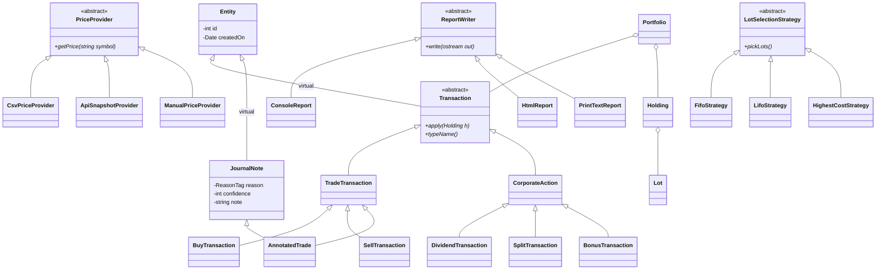

# Stock Market Portfolio Tracker

A C++ console application that records **every stock transaction** you make and shows what you own, what each stock has done for you, and exactly how you got there. Built as an Object-Oriented Programming course project (team of 4).

> **Status:** in development. See the [progress checklist](#progress-checklist) for what is finished.
> **Disclaimer:** educational project. Not financial, investment or tax advice. See [Disclaimer](#disclaimer).

---

## Table of contents

1. [About the project](#about-the-project)
2. [Features](#features)
3. [Screenshots](#screenshots)
4. [OOP concepts demonstrated](#oop-concepts-demonstrated)
5. [Getting started](#getting-started)
6. [Usage](#usage)
7. [How the numbers are calculated](#how-the-numbers-are-calculated)
8. [Data files and formats](#data-files-and-formats)
9. [Price data](#price-data)
10. [Standout features in detail](#standout-features-in-detail)
11. [Architecture](#architecture)
12. [Project structure](#project-structure)
13. [Error handling](#error-handling)
14. [Testing](#testing)
15. [Design decisions](#design-decisions)
16. [Troubleshooting](#troubleshooting)
17. [Progress checklist](#progress-checklist)
18. [Contributing and Git workflow](#contributing-and-git-workflow)
19. [Team](#team)
20. [License](#license)
21. [Disclaimer](#disclaimer)
22. [Acknowledgements](#acknowledgements)

---

## About the project

Investors usually see only their *current* holdings. This tracker keeps the whole story instead:

- **Every transaction is a permanent record**: buy, sell, dividend received, stock split, bonus shares. Records are only ever added, never edited, so the history can always be replayed.
- **Every stock of interest is tracked**, including stocks on your watchlist that you have not bought yet.
- **Every price refresh is logged**, so each stock builds a price history of its own.

The program is a menu-driven console application written in C++14. It writes HTML and print-ready text reports to disk. All data is stored in files (C++ file streams); there is no database and no third-party library.

**Scope:** Indian markets (NSE and BSE), amounts in rupees, whole shares only, one user, one portfolio.

---

## Features

**Core**

- Add, list and filter transactions (buy, sell, dividend, split, bonus)
- Holdings with average cost, last price, market value and unrealised profit or loss
- Realised profit or loss from sales, and dividend income
- Full history of any single stock (transactions plus logged prices)
- Watchlist of stocks you follow
- Price refresh from a CSV file, a saved API snapshot, or manual entry
- Reports: console tables, HTML report, print-ready text report, CSV export
- Command-line options for scripted use
- Indian digit grouping in amounts (for example `12,34,567.00`)

**Standout features** (details [below](#standout-features-in-detail))

1. **Time Travel Replay**: see the portfolio exactly as it stood on any past date.
2. **Tax-Lot What-If Simulator**: preview profit and estimated tax before you sell.
3. **Decision Journal and Regret Meter**: tag each trade with a reason and learn which of your reasons actually worked.

---

## Screenshots

_Add screenshots to `docs/screenshots/` and link them here before submission._

| Screen | File |
| --- | --- |
| Main menu | `docs/screenshots/menu.png` |
| Holdings table | `docs/screenshots/holdings.png` |
| HTML report | `docs/screenshots/report.png` |
| Time Travel | `docs/screenshots/time-travel.png` |

---

## OOP concepts demonstrated

The project follows a C++-only syllabus (Units 1 to 5). No Java, no STL containers, no external libraries.

| Unit | Topic | Where to find it |
| --- | --- | --- |
| 1 | Classes, objects, methods, message passing | `Portfolio::addTransaction()`, `Menu` calling services |
| 1 | Encapsulation, abstraction, information hiding | Private data in `Money`, `Holding`, `Portfolio` |
| 1 | Namespaces | `namespace portfolio` with `core`, `io`, `pricing` inside |
| 1 | Structure and enumeration | `TransactionRecord` struct; `enum TxnType`, `enum ReasonTag` |
| 1 | Static and dynamic binding | Non-virtual helpers versus virtual `Transaction::apply()` |
| 2 | Constructors (default, parameterised, copy), overloading, default arguments | `Date`, `Money`, deep-copy `Portfolio(const Portfolio&)` |
| 2 | Destructor, `new` and `delete`, memory management | `Portfolio` owns `Transaction*` objects |
| 2 | Static members, inline functions, friend functions | `Transaction::nextId`, inline getters, `operator<<` |
| 2 | Pointers: arrays of pointers, `this`, function pointers, pointer to pointer | Transaction lists, chained report setters, menu filters, monthly grid |
| 3 | Inheritance: single, multilevel, hierarchical, multiple, hybrid | `Transaction` family, `AnnotatedTrade` |
| 3 | Virtual base class, abstract class, pure virtual, virtual destructor | `Entity`, `Transaction`, `PriceProvider`, `ReportWriter` |
| 3 | Friend class, function and operator overloading | `HtmlReport` is a friend of `Portfolio`; `+ - < == << >>` |
| 3 | Runtime polymorphism | One loop calling `apply()` on every transaction type |
| 4 | Exceptions: multiple catch, rethrow, user-defined, inheritance | `PortfolioException` family |
| 4 | Templates: function, class, non-type parameters, friend | `DynamicArray<T>`, `FixedStack<T, N>`, `Table<K, V>` |
| 5 | File streams: text and binary, file pointers, error handling | `TransactionStore` |
| 5 | Overloaded `<<` and `>>`, memory as a stream, command-line arguments | Text export, `ostringstream`, `argc` and `argv` |

---

## Getting started

### Requirements

| Tool | Version | Purpose |
| --- | --- | --- |
| g++ | 9 or newer | Compiler (C++14) |
| CMake | 3.15 or newer | Build system |
| Git | any recent | Version control |
| curl | any | Optional: fetch live prices (preinstalled on Windows 10/11, macOS and most Linux) |
| VS Code | optional | Editor, with the *C/C++* and *CMake Tools* extensions |

### Install the toolchain

**Windows (MSYS2)**

1. Install MSYS2 from <https://www.msys2.org>.
2. Open the *MSYS2 UCRT64* shell and run:

   ```bash
   pacman -S --needed mingw-w64-ucrt-x86_64-gcc mingw-w64-ucrt-x86_64-cmake \
                      mingw-w64-ucrt-x86_64-ninja mingw-w64-ucrt-x86_64-gdb git
   ```

3. Add `C:\msys64\ucrt64\bin` to your Windows `PATH` so VS Code can find the compiler.

**Ubuntu or Debian**

```bash
sudo apt install build-essential cmake gdb git
```

**macOS**

```bash
xcode-select --install
brew install cmake
```

### Build and run

```bash
git clone <repo-url>
cd portfolio-tracker

cmake -S . -B build -G Ninja -DCMAKE_BUILD_TYPE=Debug   # drop "-G Ninja" on Linux or macOS if you like
cmake --build build

./build/portfolio_tracker        # on Windows the file is build/portfolio_tracker.exe
```

**Without CMake** (single command, run from the project root; on Windows use the MSYS2 shell):

```bash
g++ -std=c++14 -Wall -Wextra -Iinclude src/*.cpp -o portfolio_tracker
```

### Build system

Minimal `CMakeLists.txt`. It builds a library of everything except `main.cpp`, so the program and the tests share the same code. Add `tests/test_main.cpp` before the first build.

```cmake
cmake_minimum_required(VERSION 3.15)
project(PortfolioTracker CXX)

set(CMAKE_CXX_STANDARD 14)
set(CMAKE_CXX_STANDARD_REQUIRED ON)
set(CMAKE_CXX_EXTENSIONS OFF)

if(NOT MSVC)
  add_compile_options(-Wall -Wextra)
endif()

file(GLOB CORE_SOURCES CONFIGURE_DEPENDS src/*.cpp)
list(REMOVE_ITEM CORE_SOURCES ${CMAKE_CURRENT_SOURCE_DIR}/src/main.cpp)
add_library(portfolio_core ${CORE_SOURCES})
target_include_directories(portfolio_core PUBLIC include)

add_executable(portfolio_tracker src/main.cpp)
target_link_libraries(portfolio_tracker portfolio_core)

file(GLOB TEST_SOURCES CONFIGURE_DEPENDS tests/*.cpp)
add_executable(run_tests ${TEST_SOURCES})
target_link_libraries(run_tests portfolio_core)
enable_testing()
add_test(NAME all_tests COMMAND run_tests)

option(ENABLE_ASAN "Build with AddressSanitizer (Linux, macOS, WSL)" OFF)
if(ENABLE_ASAN)
  target_compile_options(portfolio_core PUBLIC -fsanitize=address -g)
  target_link_options(portfolio_core PUBLIC -fsanitize=address)
endif()
```

---

## Usage

### Interactive menu

Run the program with no options:

```text
=== Portfolio Tracker ===
 1  Add transaction
 2  View all transactions
 3  Holdings and profit/loss
 4  History of one stock
 5  Watchlist
 6  Refresh prices
 7  Reports (console / HTML / print / CSV)
 8  Time Travel
 9  What-If Sell Simulator
10  Decision Journal and Regret Meter
 0  Exit
```

Dates are typed as `YYYY-MM-DD`. Symbols carry an exchange suffix: `.NS` for NSE or `.BO` for BSE (for example `TCS.NS`).

### Command-line options

| Option | Meaning | Default |
| --- | --- | --- |
| `--data-dir <path>` | Folder that holds the data files | `./data` |
| `--prices <csv\|api\|manual>` | Price source | `csv` |
| `--report <console\|html\|print\|csv>` | Generate a report and exit, without the menu | none |
| `--as-of <YYYY-MM-DD>` | Show the portfolio as it was on that date (use with `--report`) | today |
| `--help` | Print usage and exit | |
| `--version` | Print the version and exit | |

Examples:

```bash
./build/portfolio_tracker --report html                         # writes reports/portfolio.html
./build/portfolio_tracker --report console --as-of 2026-03-31   # Time Travel from the command line
./build/portfolio_tracker --data-dir ./demo-data --prices csv
```

### Sample session

_Made-up data, for illustration only._

Transactions entered:

| Date | Type | Symbol | Qty | Price or amount | Fees |
| --- | --- | --- | --- | --- | --- |
| 2026-01-05 | BUY | DEMOSTOCK.NS | 10 | 1,000.00 | 20.00 |
| 2026-03-20 | SELL | DEMOSTOCK.NS | 4 | 1,200.00 | 20.00 |
| 2026-04-15 | DIVIDEND | DEMOSTOCK.NS | 6 held | 5.00 per share | 0.00 |

With a last price of 1,100.00, menu option 3 shows:

```text
SYMBOL         QTY   AVG COST   LAST PRICE   MARKET VALUE   UNREALISED P&L
DEMOSTOCK.NS     6   1,002.00     1,100.00       6,600.00           588.00

Realised profit (sales)   :     772.00
Dividend income           :      30.00
Unrealised profit (open)  :     588.00
Total return              :   1,390.00
```

---

## How the numbers are calculated

| Quantity | Rule |
| --- | --- |
| Cost of a buy | Quantity times price, **plus** fees. Per-share cost = that total divided by quantity |
| Average cost | Total remaining cost divided by remaining shares |
| Which shares a sale uses | First in, first out (FIFO). The oldest buy lot is sold first |
| Realised profit | Sale proceeds (quantity times price, **minus** fees) minus the cost of the lots sold |
| Unrealised profit | (Last price times shares held) minus the cost of those shares |
| Dividend income | Dividend per share times shares held on the record date |
| Split `new:old` | A `2:1` split turns 1 share into 2. Quantity rises, per-share cost falls, **total cost is unchanged** |
| Bonus `bonus:held` | A `1:1` bonus gives 1 free share for every 1 held. Quantity rises, total cost is unchanged |
| Total return | Realised profit + unrealised profit + dividend income |

Worked check for the sample above: the 10 shares cost 10,020.00 (10 × 1,000 + 20 fees), so 1,002.00 each. Selling 4 removes 4,008.00 of cost and brings in 4,780.00 (4 × 1,200 − 20), so realised profit is 772.00. The remaining 6 shares cost 6,012.00 and are worth 6,600.00, so unrealised profit is 588.00. Dividend is 6 × 5.00 = 30.00.

Money is stored as whole **paise** (`long long`), never as `double`, so rupee sums are exact.

---

## Data files and formats

```text
data/
├── transactions.dat      binary, created at run time (git-ignored)
├── prices.csv            last known prices (sample file committed)
├── watchlist.txt         one symbol per line
├── price_history.csv     appended on every price refresh
└── api_snapshot.json     written by scripts/fetch_prices (git-ignored)
config/
├── api_fields.cfg        base URL and field names for the API snapshot
└── tax_rules.cfg         rates used by the What-If Simulator
reports/                  generated reports (git-ignored)
```

### `transactions.dat` (binary)

A header followed by fixed-size records.

| Part | Content |
| --- | --- |
| Header | Magic text `PTRK` (4 bytes), format version (`int`), record count (`int`) |
| Records | One `TransactionRecord` each, appended in order |

```cpp
struct TransactionRecord {
    int       id;
    int       type;          // 0 BUY, 1 SELL, 2 DIVIDEND, 3 SPLIT, 4 BONUS
    char      symbol[16];    // for example "TCS.NS"
    int       day, month, year;
    int       quantity;      // shares bought or sold; shares held on the record date for a dividend
    long long amountPaise;   // price per share, or dividend per share
    long long feesPaise;     // brokerage, taxes and other charges
    int       ratioNum, ratioDen;   // SPLIT and BONUS only
    int       reasonTag;     // 0 none, 1 news, 2 valuation, 3 tip, 4 technical, 5 long-term, 6 FOMO
    int       confidence;    // 1 to 5, Decision Journal
    char      note[48];
};
```

A polymorphic object cannot be written to a file directly, because it contains a hidden pointer to its virtual table. The program therefore saves this plain struct and rebuilds the right class (`BuyTransaction`, `SellTransaction`, and so on) when loading.

> The exact byte layout depends on the compiler and operating system (struct padding). Treat `transactions.dat` as a local file. To move data between laptops, use the text export (**Reports, CSV export**) and import it again.

### Text export / import (CSV)

```text
id,type,date,symbol,quantity,amount_paise,fees_paise,ratio_num,ratio_den,reason,confidence,note
1,BUY,2026-01-05,DEMOSTOCK.NS,10,100000,2000,0,0,VALUATION,4,first position
2,SELL,2026-03-20,DEMOSTOCK.NS,4,120000,2000,0,0,NONE,0,
```

### `prices.csv`

```text
symbol,last_price,as_of
DEMOSTOCK.NS,1100.00,2026-10-30
```

### `watchlist.txt`

```text
# one symbol per line; lines starting with # are ignored
DEMOSTOCK.NS
ANOTHERDEMO.BO
```

### `price_history.csv`

```text
symbol,price,date,source
DEMOSTOCK.NS,1100.00,2026-10-30,csv
```

### `config/tax_rules.cfg`

```text
# Estimates only. Check the Income Tax Department website before use; rules change.
long_term_days=365
short_term_rate_percent=20
long_term_rate_percent=12.5
long_term_exemption_rupees=125000
```

### `config/api_fields.cfg`

```text
# Fill these in after the Day 1 API check (see "Price data").
base_url=REPLACE_WITH_API_BASE_URL
price_key=REPLACE_WITH_KEY_FROM_API_RESPONSE
```

---

## Price data

The program never makes network calls itself. It reads prices through one abstract class, `PriceProvider`, and a base-class pointer chooses the source at run time.

| Provider | Reads from | Select with |
| --- | --- | --- |
| `CsvPriceProvider` | `data/prices.csv` | `--prices csv` (default) |
| `ApiSnapshotProvider` | `data/api_snapshot.json` | `--prices api` |
| `ManualPriceProvider` | Typed by the user | `--prices manual` |

### Live prices through the API

Live prices use the free [Indian-Stock-Market-API](https://github.com/0xramm/Indian-Stock-Market-API) (MIT licence, no key). It serves NSE and BSE quotes built on Yahoo Finance data. A helper script saves its reply to a file, and `ApiSnapshotProvider` reads that file.

```bash
# Linux or macOS: scripts/fetch_prices.sh
curl -s "$BASE_URL/stock/list?symbols=DEMOSTOCK.NS,ANOTHERDEMO.BO&res=num" -o data/api_snapshot.json
```

```bat
:: Windows: scripts\fetch_prices.bat
curl -s "%BASE_URL%/stock/list?symbols=DEMOSTOCK.NS,ANOTHERDEMO.BO&res=num" -o data\api_snapshot.json
```

Set `BASE_URL` to the API's address (the hosted copy listed on the API repository, or your own self-hosted copy). Then refresh from the menu (**6**) or start with `--prices api`.

Things to know:

- The API's README lists no endpoint for historical prices. The tracker builds its own history by logging each refresh to `data/price_history.csv`.
- The public hosted copy is run by one person and can go offline. If a refresh fails, the program reports `PriceUnavailableException` and keeps using the last known prices from `prices.csv`.
- Data may be delayed. The API's own disclaimer says it is for education only.

---

## Standout features in detail

### Time Travel Replay

Shows the portfolio exactly as it stood on a past date.

```bash
./build/portfolio_tracker --report console --as-of 2026-03-31
```

Or choose menu option **8**, which can also compare two dates and list what changed. It works because transactions are never edited: the program replays the stored records up to the chosen date, including splits and bonus shares before that date.

### Tax-Lot What-If Simulator

Menu option **9**. Enter a hypothetical sale (symbol, quantity, price) and the program shows profit, the short-term and long-term split, and an **estimated** tax. It also reports when each lot turns long-term, so you can see what waiting would change.

- The simulation runs on a deep copy of the portfolio. Nothing is saved.
- `FifoStrategy` gives the headline result. `LifoStrategy` and `HighestCostStrategy` are shown as **comparison only**.
- Rates come from `config/tax_rules.cfg`. Every result is labelled *estimate, not tax advice*.

### Decision Journal and Regret Meter

When you add a buy or sell, you can attach a reason tag (news, valuation, tip, technical, long-term, FOMO), a confidence score from 1 to 5 and a short note. Menu option **10** then ranks your reasons by real results: average return and win rate per reason, plus your best and worst decisions.

Return of a tagged buy = (current price, or sale price if sold, minus buy price) divided by buy price.

---

## Architecture

Three layers. Domain classes never print or touch files, so each layer can be tested alone.

```text
Interface layer   Menu, command-line options, table printer
        |
Services layer    Portfolio, TimeTravel, TaxLotSimulator, DecisionJournal
        |                          |
Domain layer                 Storage and I/O layer
Transaction family,          TransactionStore, PriceProvider family,
Instrument family,           PriceHistoryLog, ReportWriter family
Holding, Lot, Date, Money
```

### Class diagram (core)



`AnnotatedTrade` is a real diamond: it reaches `Entity` through both `TradeTransaction` and `JournalNote`, and the virtual base makes them share one copy.

---

## Project structure

```text
portfolio-tracker/
├── CMakeLists.txt
├── README.md
├── LICENSE
├── .gitignore
├── config/              api_fields.cfg, tax_rules.cfg
├── data/                sample prices.csv and watchlist.txt; runtime files stay local
├── docs/                api_sample.json, screenshots/
├── include/portfolio/
│   ├── core/            Date, Money, Entity, Transaction and its subclasses,
│   │                    JournalNote, AnnotatedTrade, Instrument, Stock, Etf,
│   │                    Lot, Holding, Portfolio
│   ├── util/            DynamicArray<T>, FixedStack<T, N>, Table<K, V>,
│   │                    Algorithms (function templates), RecentSymbols
│   ├── errors/          PortfolioException and subclasses
│   ├── io/              TransactionRecord, TransactionStore,
│   │                    ReportWriter, ConsoleReport, HtmlReport, PrintTextReport
│   ├── pricing/         PriceProvider, CsvPriceProvider, ApiSnapshotProvider,
│   │                    ManualPriceProvider, PriceHistoryLog
│   ├── services/        TimeTravel, TaxLotSimulator, LotSelectionStrategy
│   │                    and its subclasses, DecisionJournal
│   └── ui/              Menu, CommandLine, TablePrinter
├── src/                 one .cpp per class (flat folder) plus main.cpp
├── scripts/             fetch_prices.sh, fetch_prices.bat
├── reports/             generated output (git-ignored)
└── tests/               test_main.cpp and test_*.cpp
```

Suggested `.gitignore`:

```text
build/
reports/
data/transactions.dat
data/api_snapshot.json
data/price_history.csv
*.exe
*.o
```

---

## Error handling

All custom errors derive from `PortfolioException` (which derives from `std::exception`). Catch blocks go from the most specific class to the base class.

| Exception | Thrown when |
| --- | --- |
| `InsufficientSharesException` | A sale is larger than the shares held |
| `InvalidDateException` | A date does not exist (for example 31 February) or cannot be read |
| `InvalidSymbolException` | A symbol is empty or malformed |
| `FileFormatException` | A data file has a wrong header, version or damaged record |
| `PriceUnavailableException` | No price can be found for a symbol |

Other rules: average cost with zero shares throws instead of dividing by zero; destructors never throw; `main` ends with `catch (...)` and a `std::set_terminate` handler for anything unexpected.

---

## Testing

The project uses its own small test runner in `tests/` (no framework to install), built with a function template and exceptions.

```bash
cmake --build build
./build/run_tests
```

What the tests cover:

- `Date` validation and day differences
- `Money` arithmetic and rounding
- Average cost, FIFO sales, realised and unrealised profit against hand-calculated numbers
- Splits and bonus shares keep total cost unchanged
- Save, close and reload gives an identical portfolio
- A damaged file raises `FileFormatException`
- Selling more than held raises `InsufficientSharesException`

**Memory checks.** The program uses `new` and `delete`, so check for leaks before every merge to `main`:

```bash
cmake -S . -B build-asan -DENABLE_ASAN=ON    # Linux, macOS or WSL
cmake --build build-asan
./build-asan/run_tests
```

On Windows with MinGW the sanitizer is usually unavailable; run this step in WSL or use Valgrind on Linux.

---

## Design decisions

| Decision | Reason |
| --- | --- |
| Money stored as whole paise | `double` cannot represent values like 0.1 exactly; whole numbers add exactly |
| Transactions are append-only | History stays trustworthy and Time Travel becomes a simple replay |
| Save a plain `TransactionRecord`, not the object | Polymorphic objects hold a hidden virtual-table pointer that is meaningless in the next run |
| `Portfolio` has a deep copy constructor | A default copy would duplicate pointers and delete the same objects twice; the simulator needs a true copy |
| Virtual destructors on every base class | Objects are deleted through base pointers |
| Own class templates instead of STL containers | Templates are a syllabus unit, and STL containers are not |
| Prices read through `PriceProvider` | The source can change without touching any other class |
| No network code in C++ | Keeps the project inside the syllabus and avoids linking libraries on Windows |
| C++14 standard | Still accepts `throw()` exception specifications from the syllabus; C++17 removed `throw(Type)` |

---

## Troubleshooting

| Problem | Fix |
| --- | --- |
| `g++` or `cmake` not found on Windows | Add `C:\msys64\ucrt64\bin` to `PATH` and reopen the terminal |
| `The CMAKE_CXX_COMPILER could not be found` | Run `cmake` from the MSYS2 UCRT64 shell, or pass `-G Ninja` after installing Ninja |
| Amounts show `Rs.` instead of `₹` | Intentional: the Windows console often cannot print `₹` |
| The data file loads on one laptop but not another | The binary layout differs by compiler. Move data with the CSV export instead |
| `PriceUnavailableException` after a refresh | The API may be offline or the field names in `config/api_fields.cfg` are wrong. Re-run the curl command and compare with `docs/api_sample.json` |
| Linker error: undefined reference to a `static` member | Define it once in the `.cpp` file (`int Transaction::nextId = 1;`) |
| Crash when deleting transactions | Make sure the base-class destructor is `virtual` |

---

## Progress checklist

- [ ] Phase 0: toolchain, repository, CMake skeleton, API check
- [ ] Phase 1: `Date`, `Money`, exceptions, `DynamicArray<T>`, test runner
- [ ] Phase 2: `Transaction` family and `Instrument` family
- [ ] Phase 3: `Portfolio` engine (lots, holdings, profit and loss)
- [ ] Phase 4: `TransactionStore` (binary file) and text export
- [ ] Phase 5: menu and command-line options
- [ ] Phase 6: price providers and reports
- [ ] Phase 7: Time Travel, What-If Simulator, Decision Journal
- [ ] Phase 8: tests, memory checks, documentation, demo rehearsal

---

## Contributing and Git workflow

1. `main` must always build and pass the tests.
2. Create a branch per task: `feature/storage`, `feature/time-travel`, `fix/date-validation`.
3. Commit small and often, with a clear message ("Add SellTransaction FIFO lot removal").
4. Open a pull request. Another member builds it and runs `run_tests` before merging.
5. Code style: 4-space indent, `PascalCase` for classes, `camelCase` for methods, `m_` prefix for private data members, one class per header and `.cpp` pair, include guards in every header.
6. Comment *why*, not *what*, and note which syllabus concept a class demonstrates.

---

## Team

| Name | Role | Main modules |
| --- | --- | --- |
| [Member 1 name] | Foundations and tests | `Date`, `Money`, exceptions, templates, Time Travel |
| [Member 2 name] | Transactions and engine | `Transaction` family, `Portfolio`, Tax-Lot Simulator |
| [Member 3 name] | Storage and interface | `TransactionStore`, `Menu`, command-line options |
| [Member 4 name] | Prices and reports | `PriceProvider` family, report writers, Decision Journal |

Course: Object-Oriented Programming. Instructor: [name]. Submission date: [date].

---

## License

MIT License. Add a `LICENSE` file with the standard MIT text, your names and the year 2026.

---

## Disclaimer

This is a student project for learning object-oriented programming. It is not financial, investment or tax advice. Price data may be delayed or wrong, and tax figures are estimates based on rates stored in a configuration file that you must verify yourself. Do not make trading decisions from this program.

---

## Acknowledgements

- [Indian-Stock-Market-API](https://github.com/0xramm/Indian-Stock-Market-API) by 0xramm (MIT licence) for the optional live-price source, which in turn uses Yahoo Finance data.
- Our course instructor and the OOP syllabus that shaped the design.
